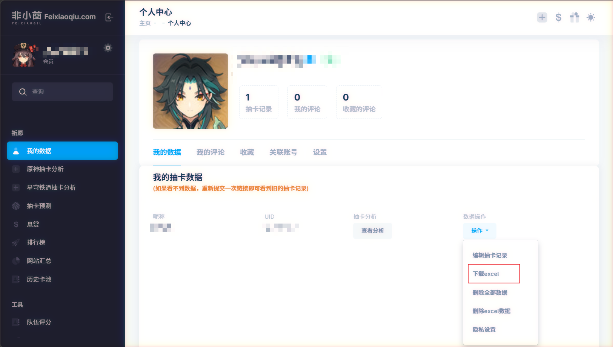
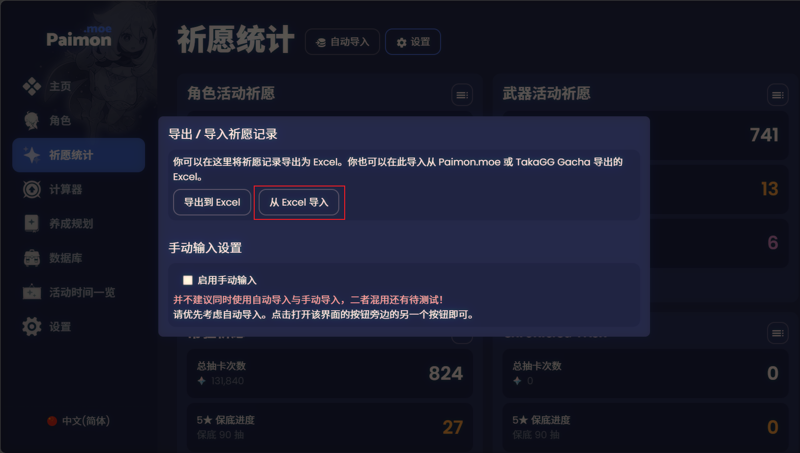

# Feixiaoqiu to Paimon.moe / UIGF Genshin Wish History Converter

[English](README.en.md) | [中文](README.md)

This project processes Genshin Impact wish history Excel files exported by **非小酋 (Feixiaoqiu)**. It reads the Feixiaoqiu xlsx file and converts it into two more portable data formats:

- **Paimon.moe Excel format**: can be used directly with Paimon.moe wish history import/export.
- **UIGF JSON format**: follows the UIGF unified interchangeable gacha record standard. The default output is the latest v4.2, with an optional v3.0 mode for scenarios that need the older format.

The conversion automatically handles Chinese/English item names, banner matching, pity/roll/group fields, and preserves the original data as completely as possible.

## Project Structure

```text
feixiaoqiu-to-paimonmoe/
├── converter.py              # Convert to Paimon.moe Excel
├── gui.py                    # GUI
├── to_uigf.py                # Convert to UIGF JSON (v4.2 / v3.0)
├── create_demo_data.py       # Generate demo data
├── update_data.py            # Refresh bundled data
├── build_exe.bat             # Build Windows exe
├── requirements.txt
├── VERSION
├── README.md
├── README.en.md
├── data/
│   ├── zh_to_en_items.json   # Chinese item name -> English item name
│   ├── item_ids.json         # Paimon.moe item IDs
│   ├── uigf_numeric_item_ids.json  # UIGF numeric item_id mapping
│   └── banners.json          # Banner schedule + dual banner info
├── pic/
│   ├── 非小酋_导出excel示例.png
│   └── paimonmoe_导入excel示例.png
└── examples/
    ├── input_demo.xlsx       # Randomly generated Feixiaoqiu-format demo input
    ├── output_demo.xlsx      # Converted Paimon.moe-format demo output
    └── output_demo.json      # Converted UIGF-format demo output
```

## Install Dependencies

```bash
pip install -r requirements.txt
```

## Convert to Paimon.moe Excel

```bash
python converter.py "feixiaoqiu_wish_history.xlsx" -o paimonmoe_wish_history_converted.xlsx
```

If no input file is given, the script automatically looks for `非小酋抽卡记录*.xlsx` in the current directory:

```bash
python converter.py
```

### Options

```bash
# Disable the Wish 2 heuristic for dual character banners
python converter.py --no-heuristic -o output.xlsx

# Specify a custom data directory
python converter.py --data-dir data -o output.xlsx
```

## Convert to UIGF JSON

Default output is UIGF v4.2:

```bash
python to_uigf.py "feixiaoqiu_wish_history.xlsx" --uid 123456789 -o uigf_wish_history.json
```

To output UIGF v3.0:

```bash
python to_uigf.py "feixiaoqiu_wish_history.xlsx" --uid 123456789 --uigf-version v3.0 -o uigf_v3.json
```

- `--uid` is required because the Feixiaoqiu Excel does not contain a UID.
- `--uigf-version` defaults to `v4.2`; use `v3.0` when the older format is needed.
- `--lang` defaults to `zh-cn`; use `en` for English item names.
- `--timezone` defaults to `8` (Asia).

```bash
# English output
python to_uigf.py "feixiaoqiu_wish_history.xlsx" --uid 123456789 --lang en -o uigf_en.json

# Disable the 400 heuristic for dual character banners
python to_uigf.py "feixiaoqiu_wish_history.xlsx" --uid 123456789 --no-heuristic -o uigf.json
```

## Demo Data

The repository includes randomly generated demo data:

```bash
python converter.py examples/input_demo.xlsx -o examples/output_demo.xlsx
python to_uigf.py examples/input_demo.xlsx --uid 123456789 -o examples/output_demo.json
```

Regenerate the demo data:

```bash
python create_demo_data.py
```

## Output Sheets (Paimon.moe Excel)

| Sheet | Description |
|---|---|
| Character Event | Character event wishes |
| Weapon Event | Weapon event wishes |
| Standard | Standard wishes |
| Beginners' Wish | Novice wishes |
| Chronicled Wish | Chronicled wishes (extra sheet; Paimon.moe Excel import ignores it) |
| Banner List | Banner schedule |
| Information | Export information |

## Update Data

When new versions, banners, or items are released, refresh the bundled data:

```bash
python update_data.py
```

This fetches from public data sources:

- Chinese/English item name mapping
- UIGF numeric item_id mapping
- Banner schedule and dual banner info

## Standalone Executable (No Python Required)

The repository includes `build_exe.bat`, which automatically creates an isolated environment and builds Windows executables:

```bash
build_exe.bat
```

The outputs are generated in `dist/`:

```text
feixiaoqiu-to-paimonmoe-gui.exe   # GUI version, double-click to use (recommended)
feixiaoqiu-to-paimonmoe.exe       # CLI: convert to Paimon.moe Excel
feixiaoqiu-to-uigf.exe            # CLI: convert to UIGF JSON
```

End users do not need Python installed.

## Known Limitations

1. Feixiaoqiu does not provide specific banner names; the converter matches banners using the banner schedule.
2. Feixiaoqiu does not provide the `301/400` dual-banner marker. The converter uses a heuristic to detect `Wish 2`:
   - If a 10-pull group contains a 5-star UP character of the second banner, the whole group is marked as `Wish 2`.
   - Undetectable records default to the first banner.
3. Paimon.moe Excel import/export currently does not support Chronicled Wish, so the `Chronicled Wish` sheet is only kept to preserve data and is ignored by Paimon.moe Excel import.
4. UIGF export requires a manually provided UID.

## Screenshots

### Feixiaoqiu Excel export



### Paimon.moe Excel import



## Related Resources

- UIGF Standard: <https://uigf.org/zh/standards/uigf.html>
- Feixiaoqiu (非小酋): <https://feixiaoqiu.com/>
- Paimon.moe: <https://paimon.moe/>
- Teyvat Guide (提瓦特指南): <https://github.com/BTMuli/TeyvatGuide>
- genshin-wish-export: <https://github.com/biuuu/genshin-wish-export>
